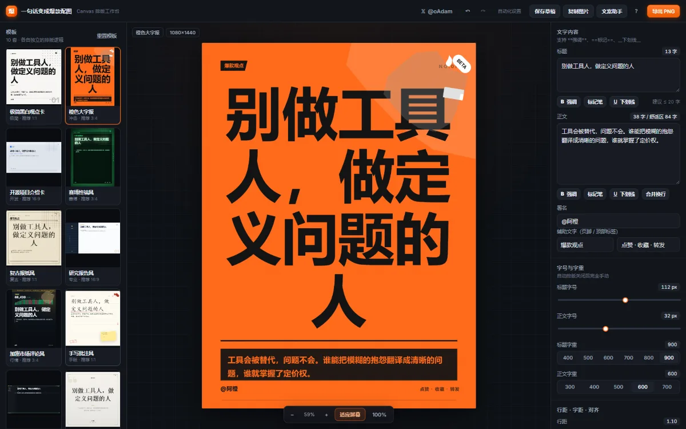
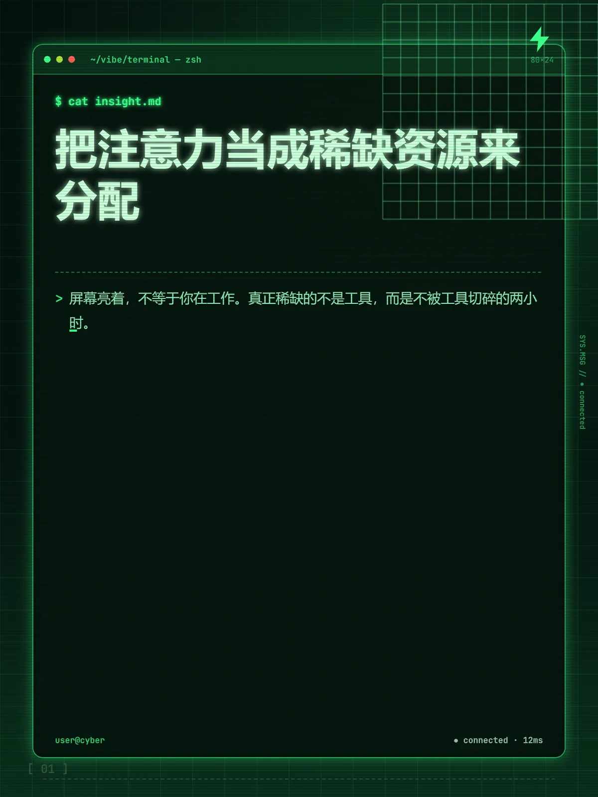
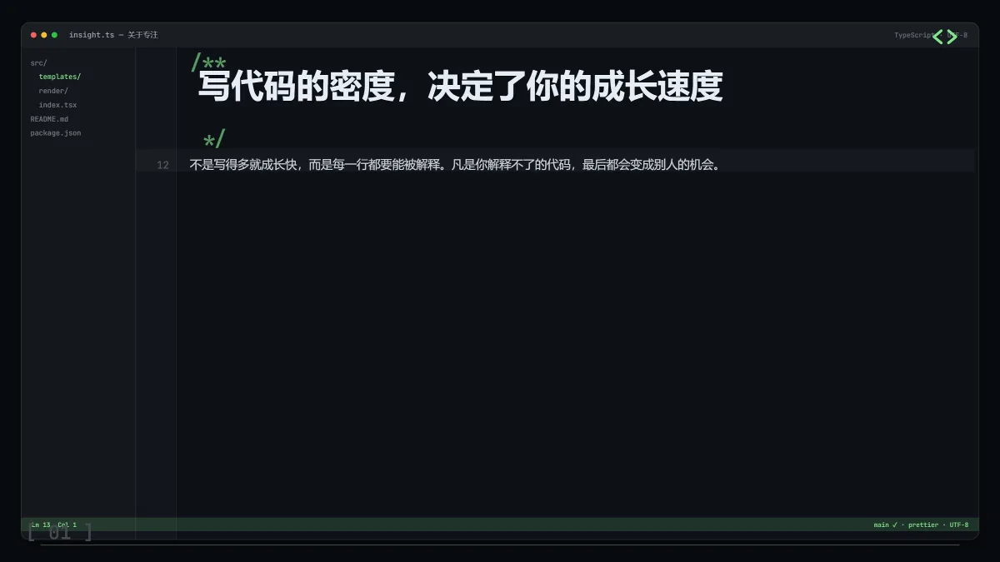
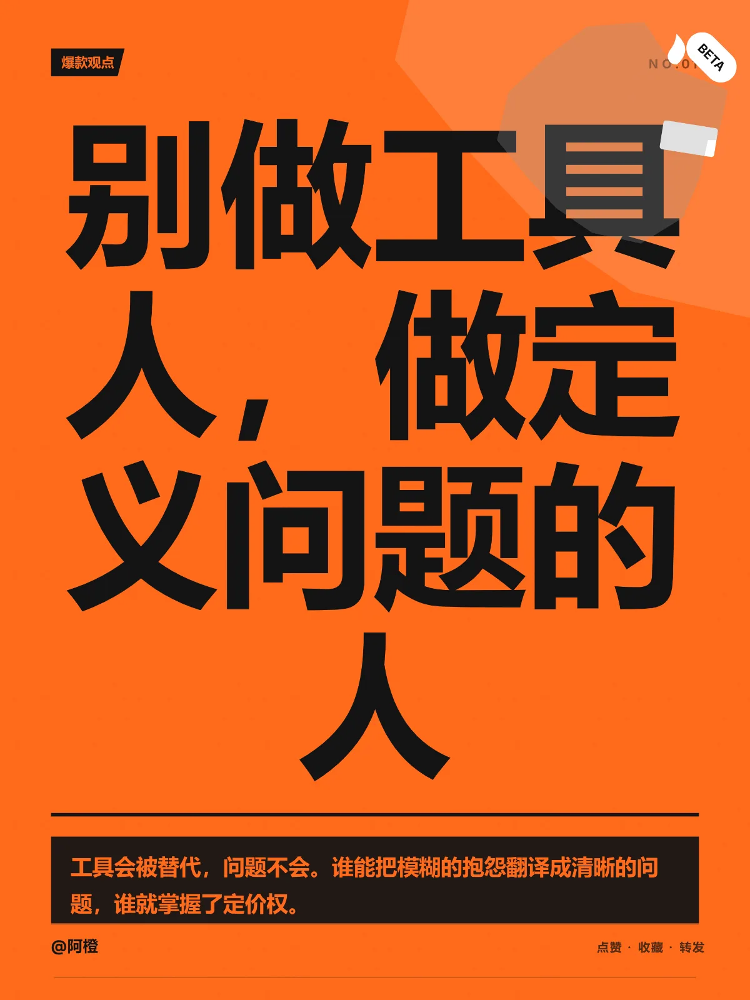
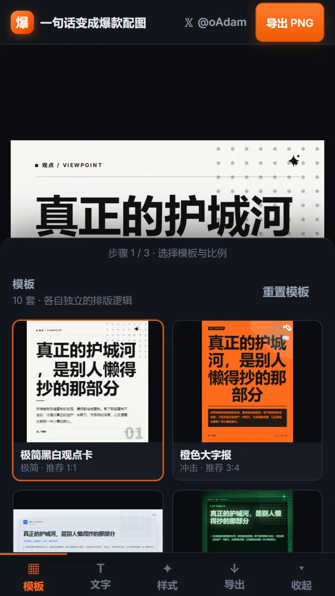
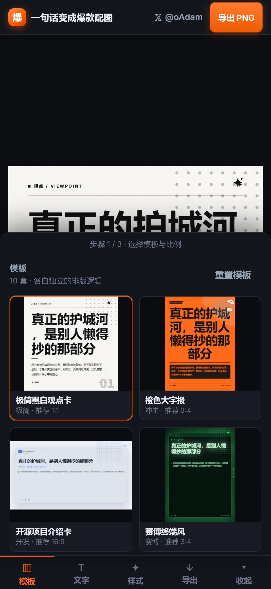
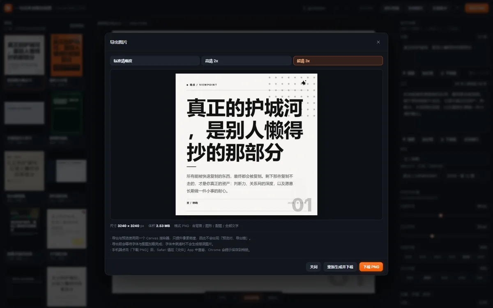

<div align="center">

# 一句话变成爆款配图

**输入一句话，选个模板，导出高清成品图。**

一个纯前端的**中文文字排版工作台**：10 套各有独立排版逻辑的视觉模板 · Canvas 单一渲染源（预览 = 导出）· 中文断行与避头尾 · 桌面三栏 / 手机分步面板

[](https://iiiiiiiiiiiiiKK.github.io/baokuan-poster/)
[](https://react.dev)
[](https://www.typescriptlang.org)
[](https://vite.dev)
[](#-测试与验收)
[](#-许可)

作者 [𝕏 @0xkillcoin](https://x.com/0xkillcoin)　·　[在线试用](https://iiiiiiiiiiiiiKK.github.io/baokuan-poster/)



</div>

---

## 这是什么

大多数「文字配图工具」给你几个固定背景图，把字往上一糊就完事。这个不一样——**它是一个真正的排版引擎**。

- 每套模板有自己的**版式骨架**：栏式报纸、终端窗口、IDE 代码窗、GitHub 仓库卡、深色侧栏报告、手写笔记纸……不是换背景色
- 预览和导出走**同一个 Canvas 渲染函数**，唯一区别是像素密度，所以永远「所见即所得」
- 中文断行做了**避头尾禁则**、**字素簇切分**（emoji 不拆开）、**超长英文单词强制拆字**
- 标题太长**自动缩小字号**而不是删你的字；正文超量会告诉你「换个模板更合适」
- 纯前端、无后端、无数据库、**配图不上传任何服务器**

<table>
<tr>
<td width="50%"><br><sub><b>复古报纸风</b> · 报头 + 多栏正文 + 首字下沉</sub></td>
<td width="50%"><br><sub><b>赛博终端风</b> · 终端窗口 + 扫描线 + 霓虹辉光</sub></td>
</tr>
<tr>
<td><br><sub><b>代码截图风</b> · IDE 窗口 + 行号 + 语法着色</sub></td>
<td><br><sub><b>橙色大字报</b> · 满版色块 + 超重居中标题</sub></td>
</tr>
</table>

---

## ✨ 功能

### 编辑

| 能力 | 说明 |
| :-- | :-- |
| **五个文字层** | 标题 / 正文 / 署名 / 顶部标签 / 页脚 |
| **富文本标记** | `**强调**`（加粗＋重点色）、`==标记笔==`（荧光底）、`__下划线__`，只改样式不改文字 |
| **精细排版** | 字号 · 字重 · 行距（1.0–2.6×）· 字间距（−4–16px）· 左中右对齐 · 5 族字体 · 4 个配色槽 |
| **装饰元素** | 11 种矢量图标 · 7 种背景图形 · 5 种分割线 · 4 种角标，任意模板上都真实生效 |
| **配图** | 本地拖拽上传，透明度 / 缩放 / 模糊 / 填满-完整可调 |
| **撤销重做** | 80 步历史，同一滑杆连续拖动自动合并成一步 |
| **草稿** | 自动保存（1.2s 防抖）＋ 手动保存 ＋ 一键恢复，存于 localStorage |
| **AI 文案** | 内置本地规则引擎（**无需 Key**）；可选接入任意 OpenAI 兼容接口 |

### 比例与导出

| 比例 | 像素 | 常见用途 |
| :-- | :-- | :-- |
| 1:1 | 1080×1080 | 头像动态、社交卡片 |
| 3:4 | 1080×1440 | 手机信息流 |
| 4:5 | 1080×1350 | 小红书 / Instagram |
| 16:9 | 1200×675 | X 横版、公众号头图 |
| 9:16 | 1080×1920 | 故事 / 短视频封面 |
| 自定义 | 240–4096 | 任意版位 |

导出三档清晰度：**标准 1×** / **高清 2×** / **超清 3×**，最长边上限 8192px 自动降倍率。
导出前 `await document.fonts.ready` + 逐字体族 `document.fonts.load()`，**字体未就绪绝不生成错图**。

---

## 🎨 十套模板

每套模板的排版逻辑都不同，不是同一张皮换个颜色。

| # | 模板 | 排版骨架 |
| :-: | :-- | :-- |
| 1 | 极简黑白观点卡 | 细线栅格 + 右上噪点块；标题锁上半区、正文底部对齐，大面积留白 |
| 2 | 橙色大字报 | 满版色块 + 斜切亮块；超重居中标题、黑底白字正文条、右上贴纸 |
| 3 | 开源项目介绍卡 | GitHub 卡片：仓库头像 + 徽章行 + 引用竖线正文 + 底部命令行 |
| 4 | 赛博终端风 | 终端窗口（三色圆点 / 标题栏）+ 提示符正文 + 扫描线 + 霓虹辉光 |
| 5 | 复古报纸风 | 报头刊名 + 双线 + 跨栏标题 + 多栏正文 + 首字下沉 + 栏间竖线 |
| 6 | 研究报告风 | 左侧深色侧栏（竖排期号）+ 右侧白底：关键数据条 + 编号摘要 |
| 7 | 加密市场评论风 | 顶部滚动行情条 + 大号价格 + 迷你 K 线（确定性随机）+ 引用式正文 |
| 8 | 手写批注风 | 横线笔记纸 + 楷体 + 手绘下划线 / 荧光笔 + 便签贴纸 + 旋转印章 |
| 9 | 代码截图风 | IDE 窗口：文件树 + 行号沟槽 + 语法着色 + 当前行高亮 + 状态栏 |
| 10 | 极简英文金句风 | 居中衬线大字 + 巨型引号 + 细线外框 + 大留白 |

> 模板缩略图**由真实渲染器生成**，不是截图贴图——左侧看到的就是成品样子。
> 每套按自己的推荐比例渲染（竖版就竖着显示），在卡片里 `contain` 居中完整展示。

---

## 🧠 中文排版规则

这是整个项目的核心，也是和「文字糊背景」工具的根本差别。

**断行**
- 以 `Intl.Segmenter` 的**字素簇**为最小单位：`👨‍👩‍👧‍👦` `🏳️‍🌈` `🇨🇳` `1️⃣` 都不会被拆开
- 中文逐字可断，英文按单词断行，行末空格不占行首
- 超长英文单词 / URL 在单词内强制拆字（避免撑破版心）

**避头尾（禁则）**
- `，。、；：？！）】》」』"…` 不出现在行首（允许 1–2 字悬挂）
- `（【《「『"` 不留在行尾

**自动适配（绝不删字）**
- 标题超出行数 / 高度 → **二分查找**最大可用字号，并提示「标题偏长，已自动缩小字号」
- 正文有 `maxHeight` 兜底，必要时缩到基准的 40%–70%
- 栏式模板（报纸 / 报告）容量不足时按列高自动降字号
- 全程**只缩不删**，用户的文字一个字都不会丢

**排版审计**
渲染器内置 `render/audit.ts`，在绘制时记录每段文字的真实包围盒，自动化测试据此断言
「文字不出画布」「正文不压页脚」——这类视觉事故能被机器发现，而不是靠人眼抽查。

---

## 📱 响应式

| 断点 | 布局 |
| :-- | :-- |
| **> 900px** | 桌面三栏：左（模板 / 比例 / 配图 / 草稿）+ 中（画布 + 缩放条）+ 右（文字 / 样式 / 装饰） |
| **≤ 900px** | 移动分步面板：底部 4 步（模板 / 文字 / 样式 / 导出）+ 底部弹出抽屉 |

移动端专项处理：

- **安全区** — `env(safe-area-inset-*)` 避开刘海与 Home Indicator
- **触控热区** — 按钮 / 选项 / 色板 / 滑杆统一 ≥ 44px（Apple HIG 建议值）
- **输入字号** — 输入框 ≥ 16px，避免 iOS Safari 聚焦时自动放大页面
- **弹窗** — 贴底显示为原生 sheet 风格，底部按钮横向铺满
- **图片完整** — 缩略图与导出预览都按原图比例 `contain`，比例误差实测 = 0

<table>
<tr>
<td width="33%"><br><sub>iPhone SE 375×667</sub></td>
<td width="33%"><br><sub>iPhone 14 Pro 393×852</sub></td>
<td width="33%"><br><sub>导出面板</sub></td>
</tr>
</table>

---

## 🚀 本地运行

需要 Node.js ≥ 20。

```bash
git clone https://github.com/iiiiiiiiiiiiiKK/baokuan-poster.git
cd baokuan-poster
npm install
npm run dev        # → http://127.0.0.1:5273
```

生产构建：

```bash
npm run build      # tsc -b && vite build → dist/
npm run preview    # 本地预览构建产物
```

`dist/` 是纯静态文件，`base: './'` 已配好，可以直接扔到任意静态托管，甚至用 `file://` 双击打开。

---

## 🧪 测试与验收

全部在**真实浏览器**里跑，不是打桩测试。

```bash
npm run verify     # typecheck → build → 5 组测试全跑
```

| 套件 | 命令 | 断言 | 内容 |
| :-- | :-- | :-: | :-- |
| E2E | `verify:e2e` | 45 | 10 套模板渲染+导出、5 种比例、3 档清晰度、换行完整性、极端内容审计、装饰/样式开关、撤销重做、草稿、布局 |
| UI 点击级 | `verify:ui` | 13 | 真实点「下载 PNG」「复制设计」「保存草稿」…并 hook `createObjectURL` 捕获下载产物 |
| 响应式 | `verify:responsive` | 49 | 7 种视口 × 7 项：横向滚动 / 元素越界 / 触控热区 / 输入字号 / 画布可见 / 顶栏重叠 / 布局模式 |
| 缩略图完整 | `verify:thumbs` | 20 | 10 套 × 桌面/移动，比例必须等于模板推荐比例且不裁切 |
| 导出预览完整 | `verify:export-preview` | 8 | 4 种比例 × 桌面/移动，渲染比例误差必须为 0 |
| 图像分析 | `verify:images` | — | 导出 PNG 非空白 + 模板两两视觉差异度 ≥ 11.9 |
| 文字覆盖度 | `verify:text` | — | 前景像素占比落在 0.4%–55%，既不是空图也不是死色块 |

**当前状态：135 条断言全部通过，0 失败。** 构建 `tsc -b && vite build` exit 0，运行期 0 JS 错误。

几个有代表性的实测数字：

- 超长中文 120 字 → 7 行，**拼接后字符数与原文完全一致**
- 超长标题 104 字 → **104/104 全部保留**，自动缩字号
- 10 套模板 × 4 类装饰 × 3 取值 = **120 次像素对比，失效 0 个**
- 同一 doc 连渲两次 → **逐字节相同**（预览 = 导出的直接证据）
- iPhone 14 Pro 上画布 374×374 @ (12,238)，完整落在 393×852 视口内

---

## 🏗 技术实现

```
src/
├─ model/          types.ts（数据模型） presets.ts（比例 / 选项 / 默认文档）
├─ render/
│  ├─ text.ts         中英文断行、字素簇、富文本解析、逐字绘制
│  ├─ layout.ts       flow() 二分查找自动缩放引擎
│  ├─ paint.ts        paintLines / paintMeta（对齐、字间距、标记笔、下划线）
│  ├─ overrides.ts    用户样式覆盖层（行距倍数 / 字距增量 / 字体 / 对齐）
│  ├─ assets.ts       噪声、纸纹、扫描线、12 个矢量图标、图形、分割线、角标
│  ├─ audit.ts        排版审计（包围盒记录 + 越界 / 重叠检测）
│  ├─ common.ts       调色板派生、标题/正文流式排版、配图绘制、分栏
│  ├─ index.ts        renderDoc()：唯一渲染入口 + 通用装饰层
│  └─ templates/      10 套模板，每套一个文件
├─ export/export.ts   PNG 导出（等字体、等图、toBlob、dataURL 降级）
├─ state/store.ts     useReducer 状态机（历史 / 草稿 / 模板切换 / 比例）
├─ ui/                App、左右栏、画布、导出弹窗、文案助手、调试钩子
└─ styles.css         工作台样式（桌面三栏 + 移动分步面板）
```

**为什么预览与导出必然一致**

```ts
// 预览
renderDoc(previewCanvas, doc, { pixelRatio: previewRatio })
// 导出
renderDoc(exportCanvas,  doc, { pixelRatio: 1 | 2 | 3 })
```

同一个函数、同一份 doc，只有 `pixelRatio` 不同。所有随机元素（噪点、纸纤维、K 线）都用**固定种子的伪随机数**，所以同一 doc 反复渲染像素完全相同。

**依赖很克制**：React 19 + TypeScript + Vite 6 + `@fontsource` 字体，没有 UI 框架、没有 CSS-in-JS、没有状态库。样式手写是为了压住工作台的控件密度。

---

## ⌨️ 快捷键

| 快捷键 | 功能 |
| :-- | :-- |
| `Ctrl/⌘ + Z` / `Ctrl/⌘ + Shift + Z` | 撤销 / 重做 |
| `Ctrl/⌘ + S` | 保存草稿 |
| `Ctrl/⌘ + D` | 复制当前设计 |
| `Ctrl/⌘ + 0` | 适应屏幕 |
| `+` / `-` | 放大 / 缩小 |
| `E` | 打开导出面板 |
| `?` | 使用说明 |

---

## 🌐 部署

<details>
<summary><b>GitHub Pages</b>（当前使用）</summary>

仓库已包含 `.github/workflows/deploy.yml`，推送到 `main` 自动构建部署。

首次需在 **Settings → Pages → Source** 选择 **GitHub Actions**。

`vite.config.ts` 已设 `base: './'`，放在 `/<repo>/` 子路径下无需改配置。

</details>

<details>
<summary><b>Vercel</b></summary>

导入仓库即可，框架预设选 **Vite**：

- Build Command：`npm run build`
- Output Directory：`dist`

无需环境变量，纯静态。

</details>

<details>
<summary><b>Cloudflare Pages</b></summary>

- Framework preset：**Vite**
- Build command：`npm run build`
- Build output directory：`dist`

也可直接把 `dist/` 上传到 R2 + 自定义域名。

</details>

<details>
<summary><b>Nginx</b></summary>

```nginx
root /var/www/baokuan-poster;
index index.html;
location / { try_files $uri $uri/ /index.html; }
```

</details>

---

## 🔒 隐私

- **没有后端**。所有渲染在浏览器里完成，图片不上传任何服务器
- 配图以 data URL 内嵌在本地文档里
- 草稿存 `localStorage`（约 5MB 上限），删除浏览器数据即消失
- AI 文案的 API Key 若填写，也只存 `localStorage`，直接由浏览器请求你指定的接口

---

## ⚠️ 已知边界

1. 中文字形依赖系统字体（PingFang SC / 微软雅黑 / 宋体 / 楷体），跨操作系统字形略有差异；**同一设备上预览与导出完全一致**
2. `navigator.clipboard.write` 在部分浏览器不可用，此时「复制图片」会提示改用下载
3. 超大自定义尺寸在 3× 导出时会按 8192px 最长边自动降倍率，导出面板显示实际输出尺寸
4. 草稿存在本机，换浏览器 / 清缓存会丢失
5. AI 文案优化需自备 OpenAI 兼容接口；**不提供 Key 时其余全部功能不受影响**

---

## ☕ 打赏

如果这个工具省了你的时间，可以请作者喝杯咖啡。

<div align="center">

</div>

---

## 📄 许可

MIT License — 随意使用、修改、商用，保留版权声明即可。

<div align="center">
<br>
<a href="https://x.com/0xkillcoin">𝕏 @0xkillcoin</a>
　·　
<a href="https://iiiiiiiiiiiiiKK.github.io/baokuan-poster/">在线试用</a>
　·　
<a href="./TEST-REPORT.md">完整测试报告</a>
</div>
